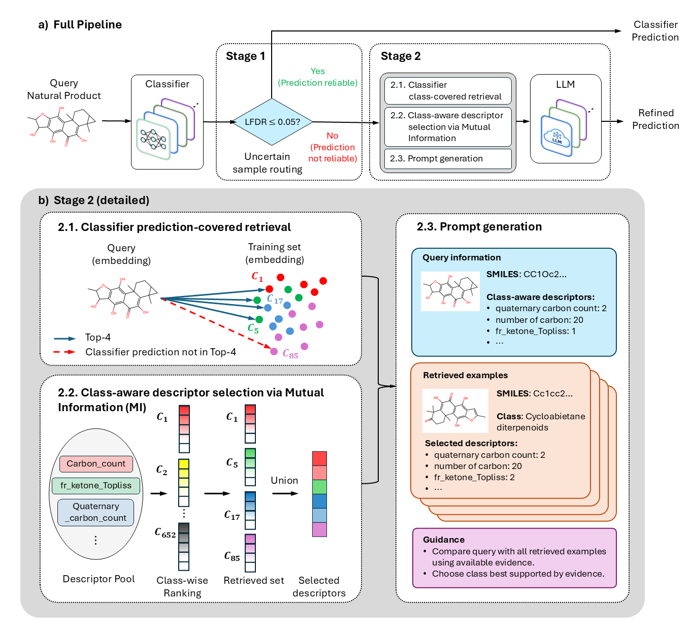

# SMART-NP

SMART-NP refines natural-product class predictions for test samples whose classifier confidence is uncertain. It uses MSP local FDR (LFDR) to route samples, retrieves training examples by backbone embedding, selects class-specific RDKit descriptors by mutual information, and asks a local GGUF LLM for a class label.



The diagram shows the full routing design. This repository's `run` command writes results **only for samples routed to the LLM** (`LFDR > 0.05`). It does not merge classifier predictions for accepted samples (`LFDR <= 0.05`) into the result file.

## Repository layout

| Path | Contents |
| --- | --- |
| `src/` | CLI, LFDR routing, embedding retrieval, descriptor ranking, prompt construction, and LLM inference |
| `scripts/` | Environment, model, and run commands |
| `configs/models.json` | GGUF model registry; default: `qwen3.5-9b` |
| `pyproject.toml`, `uv.lock` | Python dependencies, CLI entry point, and locked versions (tracked by Git) |
| `data/README.md` | Input layout and example paths |
| `SMART-NP/`, `.tools/`, `models/`, `data/descriptor-ranks/`, `data/uncertain/`, `results/` | Local environment, downloads, caches, and outputs (ignored by Git) |
| `data/dataset/` | Input directory included in Git; downloaded files remain ignored |

## Clone and download data

The 49 input files in `data/dataset/` are distributed separately as the [data-v1 release](https://github.com/happyme99/SMART-NP/releases/tag/data-v1). Clone the private repository with your GitHub credentials:

```bash
git clone https://github.com/happyme99/SMART-NP.git
cd SMART-NP
```

All commands below assume `uv` is available. If it is missing, install it once with the [official installer](https://docs.astral.sh/uv/getting-started/installation/):

```bash
curl -LsSf https://astral.sh/uv/install.sh | sh
```

On Ubuntu or Debian, if `gh` is missing, install it from the [official GitHub CLI apt repository](https://github.com/cli/cli/blob/trunk/docs/install_linux.md):

```bash
if ! command -v gh >/dev/null 2>&1; then
  sudo install -d -m 755 /etc/apt/keyrings
  curl -fsSL https://cli.github.com/packages/githubcli-archive-keyring.gpg | sudo tee /etc/apt/keyrings/githubcli-archive-keyring.gpg >/dev/null
  sudo chmod go+r /etc/apt/keyrings/githubcli-archive-keyring.gpg
  echo "deb [arch=$(dpkg --print-architecture) signed-by=/etc/apt/keyrings/githubcli-archive-keyring.gpg] https://cli.github.com/packages stable main" | sudo tee /etc/apt/sources.list.d/github-cli.list >/dev/null
  sudo apt update
  sudo apt install -y gh
fi
```

Release assets are separate from Git, so the directory starts empty.

Download the dataset:

```bash
uv run --no-project scripts/download_data.sh
```

The script opens GitHub sign-in if needed, downloads both release assets, verifies the SHA-256 checksum, and extracts the 49 input files into `data/dataset/`. It refuses to overwrite existing data.

## Setup

Choose the command for the step you want. Run it from the repository root:

| Goal | Command |
| --- | --- |
| Create the Python environment only | `./scripts/build_env.sh` |
| Create the environment, build `llama.cpp`, and download Qwen | `./scripts/build_model.sh` |
| Do the setup and run inference | `./scripts/run.sh` with the input files shown below |

`build_env.sh` uses `pyproject.toml` and `uv.lock` to create `SMART-NP/`. Keep both files in Git. `build_model.sh` also runs that step, then builds `.tools/llama.cpp/build/bin/llama-server` and downloads the default `Qwen3.5-9B-Q4_K_M.gguf` to `models/qwen3.5-9b/`. `run.sh` sets up the environment and, unless `--model-path` is supplied, also sets up the model before inference. Existing files are reused.

Requirements: Python 3.10+, `git`, `cmake`, and CUDA with `nvcc` for the default model build. For a CPU build, use `./scripts/build_model.sh --cpu` and pass `--model-path models/qwen3.5-9b/Qwen3.5-9B-Q4_K_M.gguf` to `run.sh`.

For another model, add it to `configs/models.json` and pass `--model NAME` to `build_model.sh` and `run.sh`. To download an unregistered model, supply its local path when running:

```bash
./scripts/build_model.sh --model my-model --model-repo org/repo --model-file model.gguf
# Add --model my-model --model-path models/my-model/model.gguf to the run command below.
```

## Run with the local GIN example

Input tables need `SMILES` and `true_class` columns. Embedding `.pt` files need a 2D tensor in table row order; softmax `.pt` files need `probabilities` and `class_to_idx`. Train, test, and calibration files must use matching rows within each split. The downloaded inputs under `data/dataset/` remain outside Git.

```bash
./scripts/run.sh \
  --train-table data/dataset/random_train.tsv \
  --train-embeddings data/dataset/gin_random_train_emb.pt \
  --test-table data/dataset/random_test.tsv \
  --test-embeddings data/dataset/gin_random_test_emb.pt \
  --test-softmax data/dataset/gin_random_test_softmax.pt \
  --calibration-table data/dataset/gin_random_calibration.tsv \
  --calibration-softmax data/dataset/gin_random_calibration_softmax.pt
```

The first run ranks descriptors into `data/descriptor-ranks/descriptor_selection_results.tsv` and saves routed test rows in `data/uncertain/gin_random_test_softmax_lfdr_uncertain_samples.tsv`. Later runs reuse these files. LLM predictions go to a timestamped TSV under `results/` with `SMILES`, `true`, `backbone_pred`, and `llm_pred`; printed accuracy covers those routed rows only. Use `--output PATH` for a fixed result path and `--resume` to continue that file.
